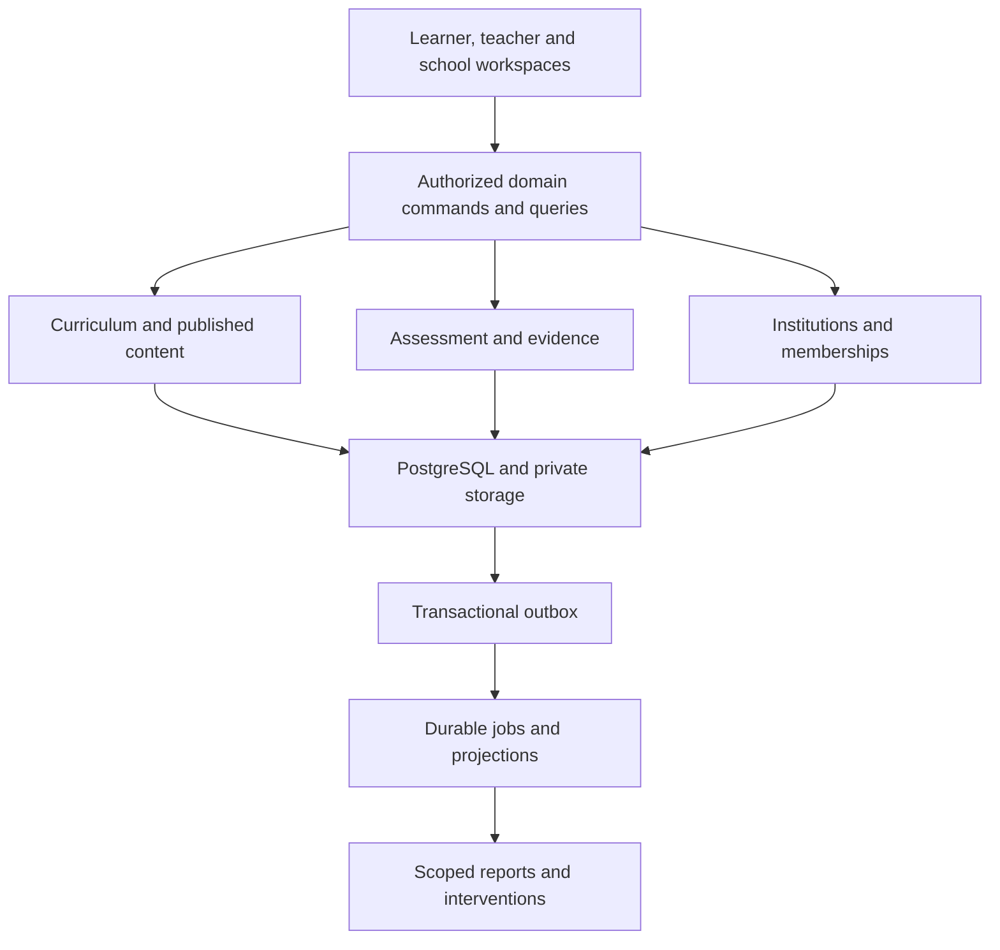

# System architecture v1.0

Status: engineering design derived from the approved Concept v1.0; implementation is pending. First release proves one Grade 12 Mathematics unit. Grades 8–12 form the initial product scope, with grade identifiers supporting R–12 later. No all-subject rollout is implied.

## Deployment and module boundaries

Use one Next.js/React/TypeScript application, Supabase Auth/PostgreSQL/private Storage, and a separately executable background worker. Begin with a modular application, not a microservice fleet. Hosting provider and worker/job product are open decisions; choose after durable job, regional, operational and cost requirements are verified. No Vercel or Sites deployment is assumed.

An offline client records permitted draft operations locally; reconnect commands pass the same live authorization and concurrency controls as online commands. All workspaces consume shared definitions, not independent dashboard formulas.

Proposed repository organization when implementation begins:

| Location | Responsibility |
| --- | --- |
| `app/` | Routes, server components and role-specific experiences |
| `src/domains/identity` | Session verification, memberships, invitations and support grants |
| `src/domains/curriculum` | Sources, versions, nodes, prerequisites and teaching plans |
| `src/domains/content` | Activity registry, review, publishing and content packs |
| `src/domains/learning` | Assignments, draft responses, completion and learner queries |
| `src/domains/assessment` | Attempts, submission snapshots, marking, moderation and release |
| `src/domains/evidence` | Artifacts, lineage and evidence access |
| `src/domains/intelligence` | Metric definitions, projections and human interventions |
| `src/domains/institutions` | Schools, classes, enrollment and academic calendars |
| `src/platform` | Logging, validation, authorization adapters, uploads and notifications |
| `workers/` | Idempotent outbox consumption, reports and pack generation |
| `supabase/migrations`, `supabase/tests` | Reproducible schema and database authorization tests |
| `tests/e2e` | Real browser journeys with distinct role sessions |

These locations describe the target; empty source folders do not constitute completed modules.

## Decisions

| ID | Decision | Reason and cost |
| --- | --- | --- |
| ADR-01 | School is the isolation tenant | Organization/district membership does not automatically grant school data access; multi-school users need explicit school memberships |
| ADR-02 | Global reviewed curriculum, tenant-owned operational data | Avoid curriculum duplication; keep school schedules, assignments and learner records isolated |
| ADR-03 | Published content and submitted work are immutable versions | Old evidence remains interpretable after edits; more versions/storage are an accepted cost |
| ADR-04 | Sensitive transitions use domain commands backed by transactions | Prevent mark forgery, tenant reassignment and inconsistent event capture; RLS remains an independent control |
| ADR-05 | Transactional outbox for facts and reporting | State and event commit together; consumers must tolerate duplicates and retry safely |
| ADR-06 | Initial reports use PostgreSQL projections | Warehouse deferred until measured scale/retention needs justify it; projection queries and indexes still require load testing |
| ADR-07 | Formal academic decisions remain human governed | AI output is advisory provenance, never silently a mark or disciplinary conclusion |
| ADR-08 | Product independence | No shared credentials, merged databases, or automatic access to BIS reflections |
| ADR-09 | Formal submissions online in first unit | Offline practice/drafts can synchronize; trusted timed/formal offline examinations require a separate design |
| ADR-10 | No experimental mastery percentage in first pilot | Show concept-level measured performance and evidence adequacy; calibration required before an inferred mastery model |

## Twelve modules and delivery boundaries

| Module | First complete workflow | Data/API boundary | Acceptance gate | Stage |
| --- | --- | --- | --- | --- |
| Curriculum engine | Import source → map → review → version | Sources, nodes, mappings, teaching plans | CUR-01–03 | First unit |
| Content studio | Author → subject review → approve → publish | Lesson/activity versions and approval records | CNT-01–03 | First unit |
| Learner workspace | Assignment → learn → practice → submit → view feedback | Learning commands; own evidence only | LRN-01–03 | First unit |
| Teacher workspace | Assigned class → work queue → mark → support | Teaching allocations and class queries | TCH-01–02 | First unit |
| Assessment/moderation | Lock submission → mark → moderate → release | Server-owned transitions and mark histories | ASM-01–04 | First unit |
| Intelligence/interventions | Concept results → teacher decision → reassessment | Metric definitions, projections and intervention records | INT-01–03 | Basic first unit; mastery later |
| Evidence/portfolios | Capture → trace version → authorized retrieval | Private artifact lifecycle and published academic evidence | EVD-01–02 | First unit |
| School administration | School → classes → allocations → enrollments | Institution commands and scoped membership | ADM-01–02 | Minimal first unit |
| Parent portal | Verify relationship → released progress → revoke | Guardian links and restricted read projection | PAR-01–02 | After core unit; permissions reserved now |
| Institutional analytics | Class evidence → school rollup → district grant | Aggregation contracts and scoped exports | RPT-01–03 | School first; district later |
| Offline/sync | Download approved pack → draft → reconcile | Pack manifest and revision/idempotency commands | OFF-01–04 | Draft/practice gate before school pilot |
| Governance | Provision → authorize → audit → revoke → restore | Identity, privacy basis, support grants, audit and operations | GOV-01–05 | Throughout |

Detailed schemas, command semantics, and gates are defined in companion documents. Modules scheduled later cannot appear as working UI links until their flows exist.

## Operational design

- Separate local/test/staging/production configurations. Synthetic data only in CI and previews. No preview deployment points to the live project by default.
- Validate supported Node/framework/Supabase versions from current official documentation at bootstrap; pin exact versions and commit the lockfile. Do not copy Applied Commerce's dependency ranges automatically.
- Use server-verified identity; never cache personal server responses in a shared CDN cache. Public immutable published assets can use content-hash caching.
- Serve learner math content without shipping answer keys, hidden rubric decisions or unreleased solutions. Renderer supports semantic math with accessible spoken/text alternatives; teacher marking uses a separate privileged query.
- Store uploads privately; quarantine and validate type/size, scan before retrieval, reject active content as appropriate, and issue short-lived signed URLs only after scoped authorization.
- Structured logs contain request/trace IDs and pseudonymous references, not answers, access tokens, names, contact details or signed URLs.
- Queue jobs claim leases, retry with bounds/backoff, record failures and expose dead-letter replay. Consumers record processed event IDs in the same transaction as projection changes.
- Proposed pilot targets: p95 ordinary server read <800 ms and mutation <1.5 s at 100 concurrent synthetic users; text-first lesson shell <=250 KB compressed excluding optional media; WCAG 2.2 AA review. These are design targets, not achieved results.
- Proposed recovery targets: RPO <=24 h and RTO <=8 h for the supervised pilot. Verify purchased backup capability and an actual restoration drill before accepting these targets.
- Maintain a rollback plan for application releases and forward repair plans for committed academic data. Destructive schema rollback is not a substitute for restoration testing.
